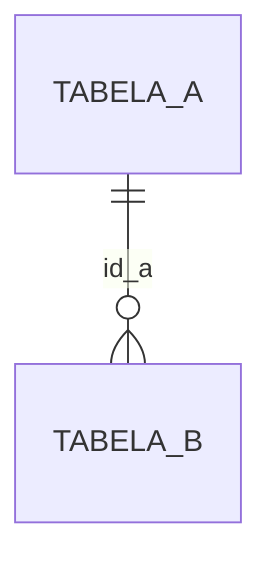

<!-- pg-atlas:auto inicio secao="cabecalho" -->
# Schema {schema}

> {n_tabelas} tabelas · {n_views} views · {n_rotinas} rotinas · {tamanho_total}

Comentário do banco: {comentário, se houver} [declarado]
<!-- pg-atlas:auto fim -->

## Do que trata

<!-- pg-atlas:pendente fase="3" -->
_Pendente: a preencher na fase 3._

{Depois de preenchido: assunto do schema em 3 a 5 frases: qual módulo do sistema, quais processos de negócio ele guarda.} [{grau}]

## Por onde começar

<!-- pg-atlas:pendente fase="3" -->
_Pendente: a preencher na fase 3._

| Pergunta | Comece por |
|---|---|
| {pergunta típica} | {tabela ou receita} |

## Grupos de tabelas

<!-- pg-atlas:pendente fase="2" -->
_Pendente: a preencher na fase 2._

### {nome do grupo}

{Descrição do grupo.}

<!-- pg-atlas:auto inicio secao="inventario" -->
## Inventário

Triagem: {classe} {n} · {classe} {n}.

| Objeto | Tipo | Linhas (est.) | Triagem | Ficha |
|---|---|---|---|---|
| {nome} | {tipo} | {linhas} | {classe} | [ficha](tabelas/{nome}.md) |
<!-- pg-atlas:auto fim -->

<!-- pg-atlas:auto inicio secao="rotinas" -->
## Rotinas

| Rotina | Tipo | Linguagem | Ficha |
|---|---|---|---|
| {nome(argumentos)} | {tipo} | {linguagem} | [ficha](funcoes/{rotina}.md) |
<!-- pg-atlas:auto fim -->

<!-- pg-atlas:auto inicio secao="sequencias" -->
## Sequências

| Sequência | Tipo | Coluna dona | Identidade |
|---|---|---|---|
| {nome} | {tipo} | {schema.tabela.coluna} | {sim/não} |
<!-- pg-atlas:auto fim -->

<!-- pg-atlas:auto inicio secao="tipos" -->
## Tipos

| Tipo | Espécie | Valores ou atributos |
|---|---|---|
| {nome} | {enum | composto | domínio} | {valores do enum, atributos ou tipo base} |
<!-- pg-atlas:auto fim -->

## Ligações com outros schemas

<!-- pg-atlas:pendente fase="2" -->
_Pendente: a preencher na fase 2._

| Daqui | Para | Por |
|---|---|---|
| {tabela} | {schema.tabela} | {coluna} |
