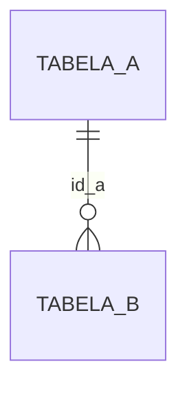

# Schema {schema}

> {n_tabelas} tabelas · {n_views} views · {n_rotinas} rotinas · {tamanho_total}

## Do que trata

{Assunto do schema em 3 a 5 frases: qual módulo do sistema, quais processos de negócio ele guarda.} [{grau}]

## Por onde começar

| Pergunta | Comece por |
|---|---|
| {pergunta típica} | {tabela ou receita} |

## Grupos de tabelas

### {nome do grupo}

{Descrição do grupo.}

<!-- pg-atlas:auto inicio secao="inventario" -->
## Inventário

| Objeto | Tipo | Linhas (est.) | Triagem | Ficha |
|---|---|---|---|---|
| {nome} | {tipo} | {linhas} | {classe} | [ficha](tabelas/{nome}.md) |
<!-- pg-atlas:auto fim -->

## Ligações com outros schemas

| Daqui | Para | Por |
|---|---|---|
| {tabela} | {schema.tabela} | {coluna} |
